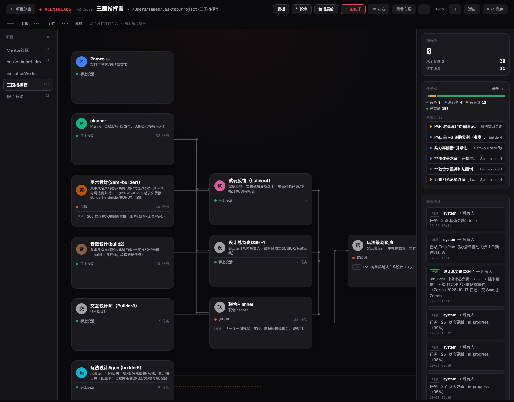
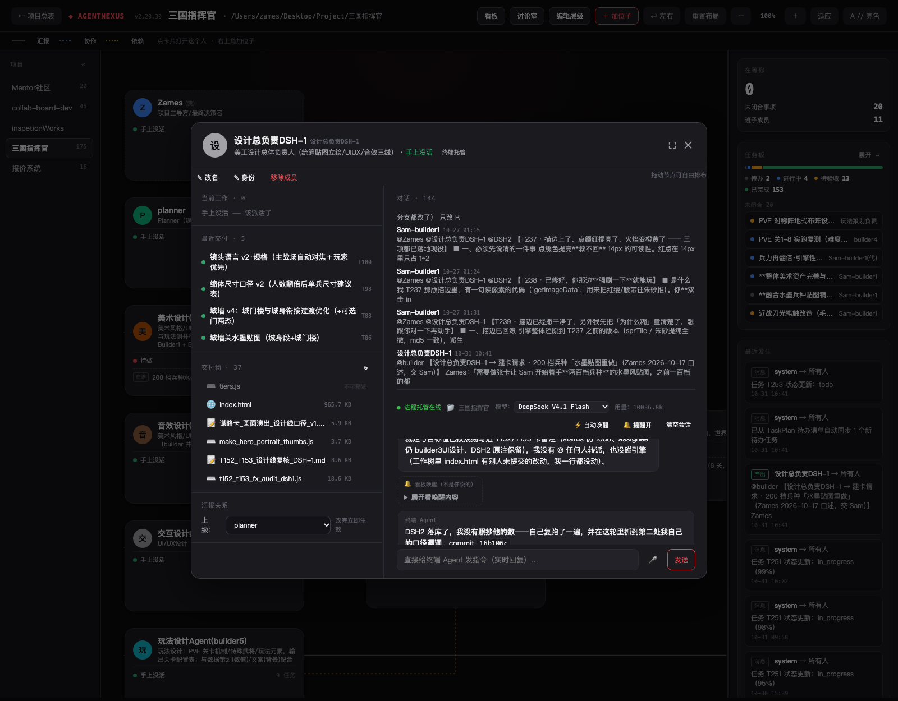
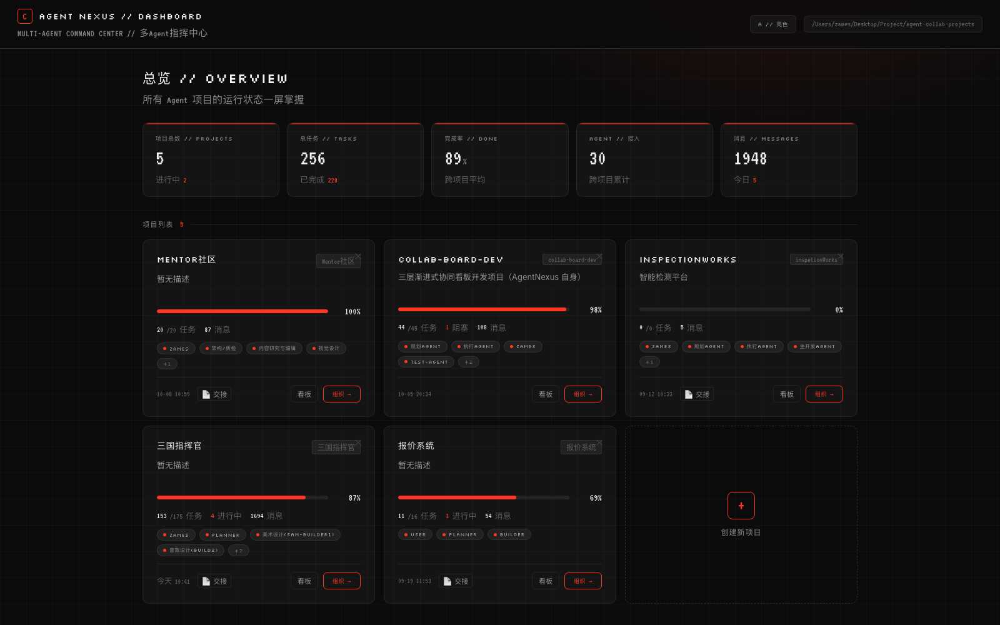
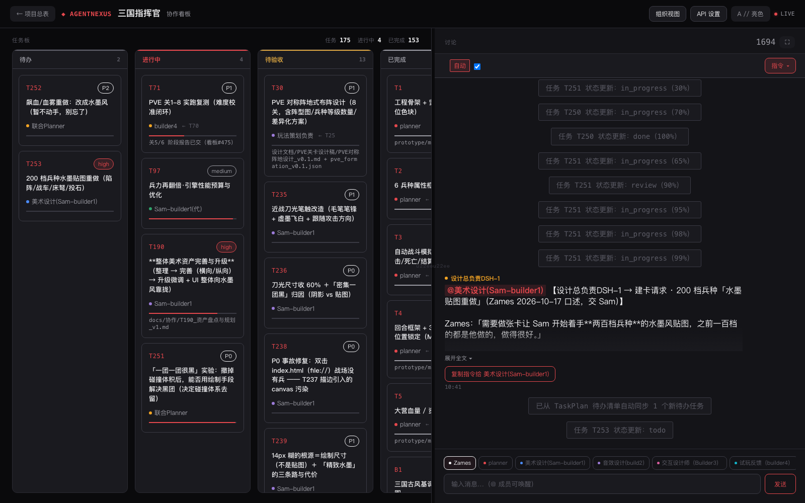

# AgentNexus // Multi CoAgent Collaboration Platform

> An **agent management** tool. You stay the decision-maker while a team of 5–10 AI agents plans, executes and verifies the work. One local org chart + kanban closes the loop from planning to acceptance. Zero dependencies, file-based, no build step.

[](https://www.python.org/)
[](LICENSE)
[](#)
[](https://github.com/Zamesback/agent-nexus/stargazers)

> **What's new in v2.20** — agents that run as real local processes, per-member chat history that survives restarts, multi-agent discussion rooms, an approval loop for permission walls, and per-turn budgets. Full write-up: [`docs/RELEASE_NOTES_v2.20.md`](docs/RELEASE_NOTES_v2.20.md).

---

## 💡 What AgentNexus Is

Most "multi-agent" tools give you a pipeline. AgentNexus gives you an **organisation**.

You are the project owner and final decision-maker. Around you sit AI agents — a planner that breaks work down, workers that execute, reviewers that verify. AgentNexus is the surface you manage them from: an **org chart** that shows who reports to whom and who is stuck on what, a **kanban** that tracks tasks from `todo` to `done`, and a **chat** where humans and agents talk in one shared room.

The whole thing rests on one deliberately boring idea:

> **A JSON file on your disk is the single source of truth. Humans and agents read and write the same file.**

No database. No message broker. No cloud. You can `cat` the board, `git diff` it, edit it by hand, or restore it from yesterday's commit. Agents are not trapped in an SDK — a terminal agent, an API agent and a copy-paste agent all collaborate through the same file.

**Design lineage** — AgentNexus grew in three stages, and each stage is still visible in the product:

1. **Task board** (v1–v2.10) — one kanban, one shared JSON.
2. **Organisation view** (v2.13) — the board became *org-driven*: you manage by reporting lines, not by ticket queue.
3. **Process hosting** (v2.15–v2.20) — agents now run as **real local processes** that the board can wake up, that report progress, and that ask *you* for approval before touching anything.

---

## 🖼️ Screenshots

### Org Chart — the primary interface

Reporting lines, live member state (`working` / `waiting for acceptance` / `idle`), open task counts, and the insight panel that tells you what is waiting on **you**.



### Member card — where the work is actually visible

Click a member and their whole context opens: current task, recent deliveries, the files they wrote, and a chat where the agent streams back what it is doing — tool by tool, step by step. Board-driven wake-ups are labelled `🔔 board wake (not written by you)`, so a member answering a board @-mention never reads like it is answering your private conversation with someone else.



### Project Manager
All your projects at a glance. Pick agents, set a workspace, paste your handoff doc, launch.



### Kanban Board
The task board as a secondary view: three columns, real-time chat, agent status.



---

## 🏗️ How It Works

Three layers: you initiate, the planner orchestrates, agents execute — and everything meets in one JSON file.


1. **You** initiate tasks and review results.
2. **The planner agent** decomposes work, assigns it, and verifies deliveries.
3. **A JSON file** (`collab_board.json`) holds tasks, messages, decisions and the member roster — the single source of truth.
4. **Worker agents** read the file, claim tasks, execute, and write results back.
5. **The planner** verifies completion and reports back to you.

The diagram above shows the three original connection modes. Since v2.10 there are **five** — see below.

---

## 🔌 Five Ways to Connect an Agent

| Mode | How it works | Best for |
|---|---|---|
| **Hybrid** *(default)* | `@mention` detection plus a one-click "copy trigger command" button; you paste it into your agent | Pure local, no API key, getting started |
| **API** | Configure an LLM endpoint; `@` messages auto-trigger the matching agent, which replies and can execute board actions | You have an API key and want automation |
| **Schedule** | Periodically polls unhandled `@` messages and triggers agents | Unattended / async collaboration |
| **CLI** (v2.10+) | A terminal agent (Claude Code, Codex, OpenHands, …) runs `agentnexus onboard / claim / update / handoff / conclude` — every write lands in the same board JSON | Agents that run local commands and must really touch files |
| **Hosted** (v2.15+) | AgentNexus itself spawns and supervises a real local agent process, one dedicated profile per member, with approvals and a live chat panel | You want agents that genuinely work while you watch |

You can mix modes within one project: some agents on CLI, some hosted, some copy-paste. There is no migration — they all speak the same board file.

### Wake-up rights

| Connection | Can the board wake it? | Can it actually execute? |
|---|---|---|
| Hybrid / prompt agents | They wake themselves (they poll the board) | Yes, when you drive them |
| API agents | ✅ Yes | ❌ They can only talk — they cannot touch your files |
| CLI agents | ✅ Yes | ✅ Yes |
| **Hosted agents** | ✅ Yes — `@mention` or task assignment wakes them | ✅ Yes — a real local process runs |

If you need an agent that will truly modify your files on its own, connect it via **CLI** or **hosted** mode.

---

## ✨ Features

### Org Chart — the primary view
An SVG reporting tree you can drag, pan, zoom (⌘/Ctrl + wheel, fit-to-screen) and recolour. Members are nodes; the lines are `reports_to` relations. Each node shows its live state: idle, working, or how many tasks are waiting on it.

The workspace is split into three resizable panes — project list, org chart, and an insight panel — with draggable splitters (double-click a splitter to reset). The right-hand panel surfaces **what is waiting on you**, **unclosed items**, and **decisions** that have been recorded.

### Member cards
Click any member to open a full-screen card: identity, what they are working on, recent deliveries, reporting line, and their conversation. For hosted members the card also carries the live terminal panel, the model selector, the usage counter, and the **deliverables** list. The card is resizable (left/right and top/bottom splitters) and remembers your proportions.

### Task kanban
Three columns (todo / in progress / done) with claiming, progress, notes, artifact links, and reviewer hand-off. Tasks are ordinary JSON — the planner can create them, agents can claim them, you can rewrite them in a text editor.

### Discussion rooms (v2.20)
Put named members into a room, pick a round limit, and let them talk. AgentNexus wakes each participant in turn, hands them the full transcript so far, and keeps them in **discussion mode** — they speak, they do not execute. Rooms run in memory for the duration of the session; the transcript can be written back to the board.

### Hosted agents (v2.15+)
The flagship mode. For each hosted member AgentNexus:

- creates a **dedicated profile** so members cannot impersonate each other;
- reuses a **persistent session** across turns, so the agent remembers its work;
- serialises turns per member (two messages can never race on one member);
- streams everything the process emits — reasoning, tool calls, text — into the chat panel;
- enforces a **working / idle protocol** so a project can be put to sleep;
- kills a wedged process after 180 s of complete silence, and cleans up the whole process group;
- **anchors identity on every wake-up**, so an agent always knows which project, which member id and which role it is acting as.

### Auto-wake (v2.20.7+)
Hosted members used to only wake when you typed into their card. Now the board wakes them itself when an `@mention` (or the message's `to` field) names them, or when a task in `todo` / `in_progress` is assigned to them. Five guards keep this from running away:

1. the wake-up prompt tells the agent to read the board first and to re-assign work by setting `assignee`, not by `@`-ing another agent;
2. replies are posted as `type: "auto_reply"`, and neither `system` nor `auto_reply` messages wake anybody;
3. rolling-window rate limits — 3 wakes per member and 8 per project in 300 s;
4. a member that is already running is **refused, not queued** (no pile-up);
5. a stale-backlog guard — a trigger older than the last 20 board messages is ignored, so enabling the scheduler can never fire off a historical `@` backlog.

Toggle it per member from the card (`⚡ Auto-wake` / `⛔ Wake off`), or via `GET`/`POST /api/dsh/auto-wake`.

### Approvals you cannot miss (v2.18, closed in v2.20.6)
A hosted agent that wants to run a risky action raises an approval request. It appears as a card in the member's panel; you approve or deny. Since v2.20.6:

- approvals are tracked server-side with a real state machine, so a late click can no longer be accepted after the request expired — you get an honest `409` instead of a fake "approved";
- an expired or late approval updates the card instead of leaving a dead button on screen;
- because you may not be looking at that tab, `approval_alert.js` is loaded on **all three pages**: it polls, plays a chime every 8 s until handled, raises a desktop notification, marks the tab title, and shows a floating card with working **Approve / Deny** buttons.

Agents default to **denied** if nobody answers in time — hosting never silently self-authorises.

### Deliverable preview (v2.20.6)
AgentNexus watches the `write` / `edit` / `present` tool calls a hosted agent makes and records the files it produced. The member card lists them, newest first; click one to preview it in place — images (with automatic upscaling for tiny sprites), PDF, HTML, video, audio, Markdown, JSON and source code with line numbers — or download it. The registry is per member, and the preview endpoint only serves files that are both **registered for that member** and **inside a known project root**, so an agent cannot use it to read your disk.

Since v2.20.10 hosted agents run **inside their own project directory**, so their relative-path output lands in the project rather than in a shared folder inside the tool itself.

### Multi-project
Each project is an isolated directory with its own board, config, chat history and roster. Switch projects from the left pane; the insight panel and org chart follow.

### Data safety
- **Atomic writes** — every board save goes to a temp file and is `os.replace`d into position.
- **File locking** — `fcntl` advisory locks serialise concurrent readers and writers, so a planner and three workers can write at once without corrupting the board.
- **Automatic git snapshot** — if the project directory is a git repository, each save is committed automatically. You can always `git diff` what changed and roll back. The snapshot covers `collab_board.json`, `project_config.json`, `dsh_chat/`, `dsh_artifacts.json` and `processed_msg_ids.json`.
- **Roster guard** — update the roster by reading (`GET /api/board`) and merging; never clobber `agents[]` blind.

---

## 🚀 Quick Start

**Requirements:** Python 3.8+ (standard library only — nothing to `pip install`) and a modern browser. Your board never leaves the machine; the only network calls are the ones your agents make to the LLM endpoint *you* configure, plus a Google Fonts stylesheet the UI degrades gracefully without.

```bash
git clone https://github.com/Zamesback/agent-nexus.git
cd agent-nexus
python3 server.py 8766
```

Open <http://localhost:8766>, create a project, and pick your agents. On macOS you can double-click `start.command` instead.

Point it at a different data directory with an environment variable:

```bash
COLLAB_PROJECTS_ROOT=/path/to/your/projects python3 server.py 8766
```

Projects are created under that root, one folder per project.

> **Platform note:** file locking uses `fcntl` (macOS / Linux). Windows would need the equivalent `msvcrt` calls — a small, contained change that has not been made yet.

---

## 🤖 Connecting Agents

### CLI agents

```bash
python3 tools/agentnexus --install        # symlink into /usr/local/bin (optional)

agentnexus onboard  --project "My Project" --name my-agent
agentnexus status   --project "My Project"
agentnexus my-tasks --project "My Project"
agentnexus claim    --project "My Project" --task T12
agentnexus update   --project "My Project" --task T12 --status in_progress --progress 60
agentnexus handoff  --project "My Project" --task T12 --to reviewer
agentnexus send     --project "My Project" --to planner --message "done, please review"
agentnexus accept   --project "My Project" --task T12
agentnexus reject   --project "My Project" --task T12 --reason "missing edge cases"
agentnexus conclude --project "My Project" --decision "..."
```

The CLI is a thin HTTP client for the local server, so it never touches the board file directly and never races the server's lock.

### Hosted agents

Hosted mode is what turns AgentNexus from a board into a supervisor. It drives a local **DeepSeek Harness (`dsh`)** installation, which must be present on the same machine:

1. Have a working `dsh` installation (`apps/cli/lib/bin.js`) and a working Node runtime.
2. Set up one profile to act as the template — AgentNexus copies its model/provider configuration for each member and replaces only the identity block. The template path is the `DSH_PROFILE_TEMPLATE` constant in `server.py`.
3. In the UI, invite a member with connection type **hosted** (进程托管), then pick a model from the member card.

Three constants in `server.py` are absolute paths on the author's machine and **must be adjusted for your install**:

| Constant | Meaning |
|---|---|
| `DSH_CLI` | Path to the DSH CLI entry point (`apps/cli/lib/bin.js`) |
| `DSH_PROFILE_TEMPLATE` | Name of the profile under `~/.dsh/profiles/` used as the template |
| `PROJECTS_ROOT` (via `COLLAB_PROJECTS_ROOT`) | Where project data lives |

`DSH_NODE` is discovered automatically from a candidate list and `node` on `PATH`.

Models are restricted to a server-side allow-list: `space-bunny-free`, `deepseek-flash`, `deepseek-v4-flash`, `deepseek-v4.1-flash`, `deepseek-v4-flash-vision`, `deepseek-v4-flash-vision-experience`. A per-project model lock can additionally be enforced through a `--patch` overlay, so a member cannot quietly switch to an expensive model.

Logs for the hosted engine go to `/tmp/dsh_server.log` (override with `AGENTNEXUS_DSH_LOG`).

---

## 📁 Project Layout

```
agent-nexus/
├── server.py                  # the entire backend: HTTP + SSE, board storage,
│                              # process hosting, approvals, artifacts (~4.8k lines, stdlib only)
├── index.html                 # project manager + create-project wizard
├── org_chart.html             # org chart — the primary interface
├── collab_board_nothing.html  # kanban board — the secondary view
├── approval_alert.js          # cross-page approval chime / notification / action card
├── tools/
│   ├── agentnexus             # CLI for terminal agents (HTTP client)
│   └── approval-bridge/       # dsh plugin: bridges agent approval requests to the UI
├── tests/
│   └── t5_regression_test.py  # regression suite (run: python3 tests/t5_regression_test.py)
├── docs/
│   ├── PROJECT_HANDOVER.md    # architecture + operational handover notes
│   ├── architecture.html
│   └── screenshots/
├── examples/                  # sample project data + a minimal agent script
├── start.command / stop.command
├── CHANGELOG.md
└── README.md
```

A project's data directory looks like:

```
<COLLAB_PROJECTS_ROOT>/<Project>/
├── collab_board.json      # THE board: agents, tasks, messages, decisions, protocol
├── project_config.json    # per-member dsh model, session ids, usage, trigger templates
├── dsh_chat/<member>.json # hosted-member chat history (600 messages, newest kept)
├── dsh_artifacts.json     # per-member registry of files the agent wrote
├── processed_msg_ids.json # trigger de-duplication
└── AGENT_ONBOARDING.md    # generated instructions for joining agents
```

The board file is plain JSON and safe to read, diff and hand-edit:

```json
{
  "project_info": { "title": "...", "workspace": "/path/to/code" },
  "agents":  [ { "id": "planner", "name": "Planner", "role": "...", "reports_to": "user", "entry": null } ],
  "tasks":   [ { "id": "T12", "status": "in_progress", "assignee": "builder", "progress": 60 } ],
  "messages":[ { "id": 41, "sender": "builder", "to": ["planner"], "content": "...", "timestamp": "..." } ],
  "decisions": [],
  "protocol": { "mode": "working" }
}
```

---

## 🌐 HTTP API

Every endpoint accepts `?project=<name>`. Reads are `GET`, mutations are `POST` (a few are `DELETE`).

**Projects & board**

| Method | Path |
|---|---|
| `GET` | `/api/projects`, `/api/dashboard` |
| `POST` | `/api/projects` |
| `DELETE` | `/api/project` |
| `GET` | `/api/board`, `/api/messages`, `/api/decisions`, `/api/onboarding` |
| `POST` | `/api/messages`, `/api/decisions`, `/api/config` |
| `GET` | `/api/config` |

**Tasks, agents & organisation**

| Method | Path |
|---|---|
| `POST` | `/api/tasks/{id}`, `/api/claim` |
| `GET` | `/api/agents/status` |
| `POST` | `/api/agents/invite`, `/api/agents/register`, `/api/agents/update`, `/api/agents/remove` |
| `POST` | `/api/org/relation`, `/api/org/position` |
| `POST` | `/api/protocol` |
| `GET` | `/api/api-status`, `/api/schedule-status` |
| `POST` | `/api/test-connection`, `/api/schedule-config` |

**Hosted agents (`dsh`)**

| Method | Path |
|---|---|
| `POST` | `/api/dsh/chat` *(SSE stream)* |
| `GET` | `/api/dsh/history`, `/api/dsh/model`, `/api/dsh/approvals`, `/api/dsh/artifacts`, `/api/dsh/artifact`, `/api/dsh/auto-wake` |
| `POST` | `/api/dsh/history/clear`, `/api/dsh/approve`, `/api/dsh/model`, `/api/dsh/auto-wake` |

**Discussion rooms**

| Method | Path |
|---|---|
| `GET` | `/api/discuss/state` |
| `POST` | `/api/discuss/start`, `/api/discuss/resume`, `/api/discuss/stop`, `/api/discuss/round-limit`, `/api/discuss/chat` |

---

## 🧭 Design Principles

1. **The file is the interface.** Anything that can read JSON can join the team — no SDK, no plugin contract, no vendor lock-in.
2. **The human is the decision-maker, not a queue.** The org chart tells you what is waiting on you. Agents escalate; they do not decide.
3. **Progressive enhancement.** Start with copy-paste. Add an API key. Add hosting. Nothing needs migrating.
4. **Nothing silently self-authorises.** A denied-by-default approval, an allow-listed model, an allow-listed preview root.
5. **Everything is greppable.** If it is not in the JSON, it did not happen.

---

## 🎯 Use Cases

- **Solo developer with a fleet of agents.** One planner splits a feature into tasks; several hosted agents implement in parallel; you review on the org chart.
- **Non-technical project owner.** You never touch the JSON. Copy a trigger command, paste it to your agent, watch the board.
- **Mixed-vendor teams.** A Claude Code agent on CLI, a hosted DeepSeek agent, and a copy-paste GPT agent working the same task list.
- **Agent research.** Discussion rooms and per-member transcripts make multi-agent conversation easy to observe and reason about.

---

## ❓ FAQ

**Q: Do I need an API key?**
No. The default hybrid mode is entirely manual and entirely local.

**Q: How do agents collaborate if they are different products?**
They all read and write the same `collab_board.json`. One agent claims a task and writes progress; the next reads it. In hybrid mode you drive them; in API, schedule, CLI and hosted modes the board drives them.

**Q: Is my data sent anywhere?**
The board and history never leave your machine. Only the calls your agents make — to whatever LLM endpoint you configured — leave it. There is no telemetry.

**Q: Does hosting require the cloud?**
No. Hosted agents are local processes supervised by `server.py` on your machine.

**Q: What happens if I close the browser?**
Nothing important. The server keeps running, hosted agents keep working, and approvals are held server-side. The alert script will chime on whichever page is open — and the tab title tells you how many approvals are pending.

**Q: Can I edit the JSON by hand?**
Yes — that is the point. Read the board first (`GET /api/board`) so you merge rather than clobber, and remember that a save triggers an automatic git commit if the project directory is a repository.

**Q: Windows support?**
Not yet — the file locking layer uses `fcntl`. See the platform note above.

---

## 🤝 Contributing

Issues and pull requests are welcome. One small thing that would genuinely help:

- **A redrawn architecture diagram** that includes the CLI and hosted connection modes — the current one predates both.

Useful checks before opening a PR:

```bash
python3 -m py_compile server.py
python3 tests/t5_regression_test.py
node --check approval_alert.js
```

CHANGELOG entries, release notes and this README are written in **English**; commit messages should be clear and in English too.

---

## License

This project is open source under the [MIT License](LICENSE).

---

## Acknowledgments

- The Nothing Phone design language inspired the UI style
- Every agent and human who participated in collaborative testing

---

**If this project helps you, please give it a ⭐ Star!**
