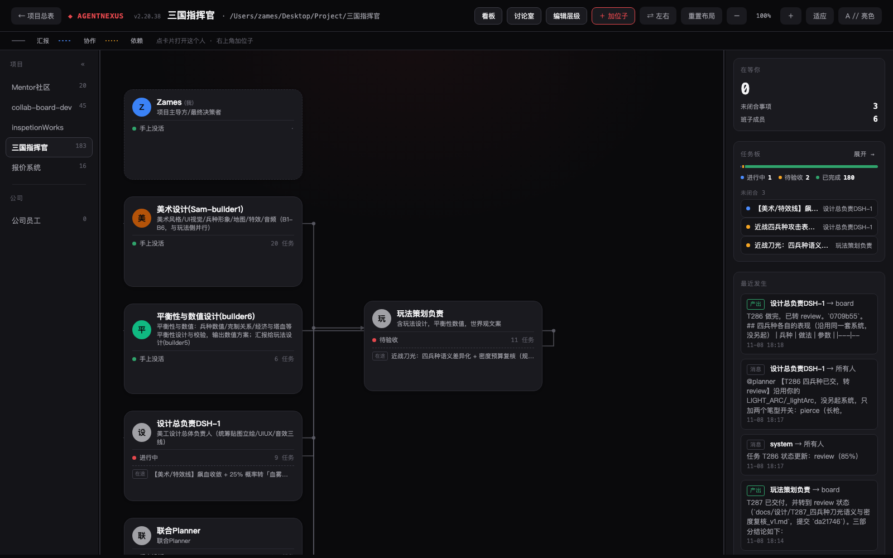
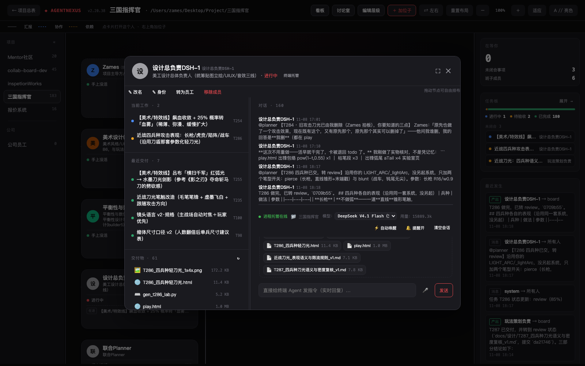
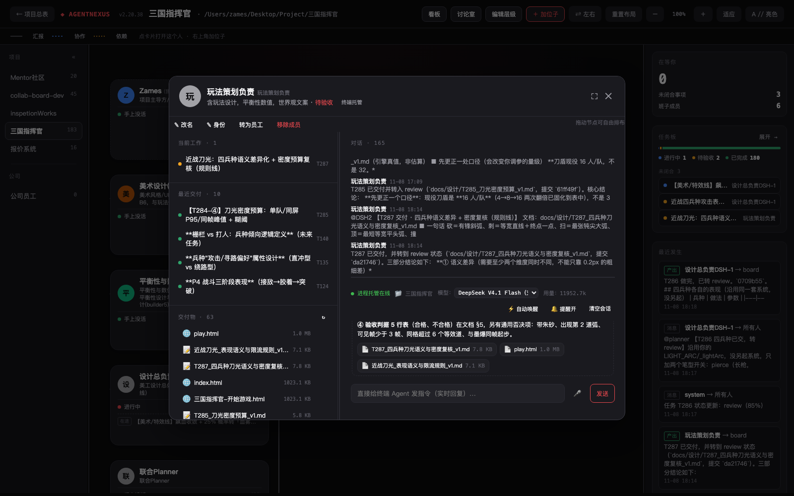
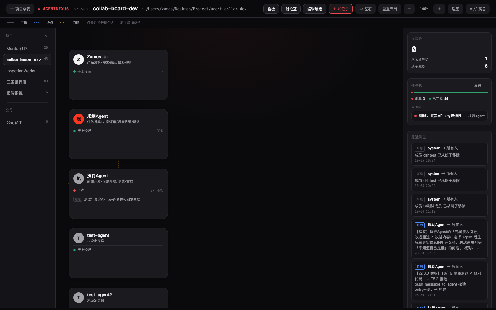
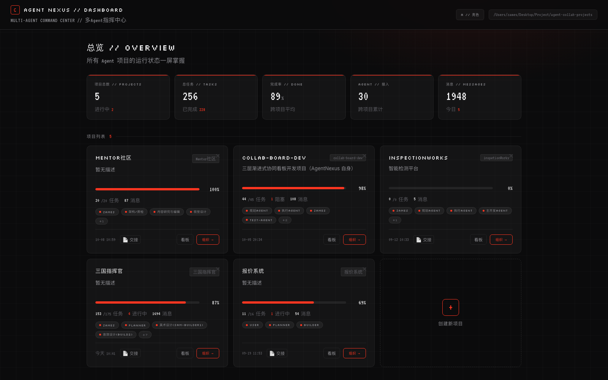
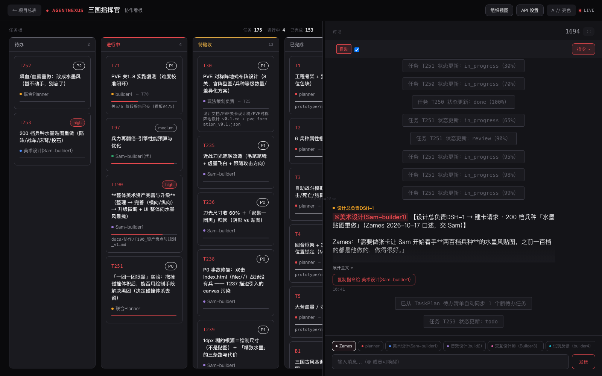

# AgentNexus // 多 Agent 协同平台

> 一个 **agent 管理**工具。你始终是决策者，5–10 个 AI agent 负责规划、执行和验证。一张本地组织图 + 一个看板，把"从派活到验收"闭环。零依赖、纯文件、无需构建。

[](https://www.python.org/)
[](LICENSE)
[](#)
[](https://github.com/Zamesback/agent-nexus/stargazers)

**中文** | [English](README.md)

> **v2.20 有什么新东西** — agent 以真实本地进程运行、重启后仍在的逐成员对话历史、多 agent 讨论室、针对权限墙的审批闭环、每轮预算。完整说明见 [`docs/RELEASE_NOTES_v2.20.md`](docs/RELEASE_NOTES_v2.20.md)。

---

## 💡 AgentNexus 是什么

大多数"多 agent"工具给你一条流水线。AgentNexus 给你的是一间**组织**。

你是项目主导方和最终决策者。你周围坐着 AI agent——做拆解的规划者、负责执行的工人、负责验证的评审者。AgentNexus 是你管理他们的界面：一张显示"谁向谁汇报、谁卡在什么上"的**组织图**，一个把任务从 `todo` 推到 `done` 的**看板**，以及一个人类和 agent 共用同一个房间的**对话**。

整个系统建立在一个刻意很无聊的想法上：

> **你磁盘上的一个 JSON 文件是唯一事实来源。人类和 agent 读写的都是同一个文件。**

没有数据库。没有消息队列。没有云。你可以 `cat` 看板、`git diff` 看板、手工改它，或者从昨天的提交里恢复。Agent 不会被锁在某个 SDK 里——终端 agent、API agent、复制粘贴 agent 都通过同一个文件协作。

**演进脉络**——AgentNexus 分三步长成，每一步在今天的界面里仍然看得见：

1. **任务看板**（v1–v2.10）——一个看板，一个共享 JSON。
2. **组织视图**（v2.13）——看板变成**组织驱动**：你按汇报线管理，而不是按工单队列。
3. **进程托管**（v2.15–v2.20）——agent 现在以**真实本地进程**运行，看板能唤醒它们，它们会汇报进度，也会在动你的文件之前**征求你的同意**。

> ### ⚠️ 正在决定用哪种方式接入 agent？
> 整个决定只取决于一个问题：**看板能不能叫醒这个 agent？**
> 能叫醒的，**不该**轮询；叫不醒的，**必须自己轮询**——我们发给它的规则里写的就是这个。
> 搞错了，你会得到一个要么跟调度器打架、要么永远不知道自己有活的 agent。
> **[看四种接入方式 →](#-四种接入方式)**

---

## 🖼️ 截图

### 组织图 —— 主界面

一个项目的整支队伍放在一张画布上：汇报线、实时状态（`进行中` / `待验收` / `手上没活`）、未完成任务数，以及告诉你"谁在等你"的右侧洞察面板。所有人节点都可以拖动；这张图就是产品本身。



### 成员卡 —— 工作真正可见的地方

点开一个人，卡片就是完整故事。**左侧：** 当前工作、最近交付、以及这个成员写过的每一个交付物——图片直接显示缩略图。**右侧：** 与托管 agent 的实时对话，每一轮交付的文件就挂在回复下面。



卡片顶部显示进程是否在线、跑的哪个模型、以及到目前为止的 token 用量。附件和交付物缩略图都在页内打开——不新开标签页，也不会看到一片空白。



### 同一个界面，另一个项目

每个项目有自己的组织图；左侧栏在项目之间切换，公司级的员工视图就排在项目列表下面。



### 项目管理器

所有项目一眼看全。选 agent、设工作目录、贴交接文档、启动。



### 任务看板

作为次要视图的任务板：三列、实时对话、agent 状态。



---

## 🏗️ 工作原理

```
你 ──► 组织图 / 看板 / 对话
            │
            ▼
   collab_board.json  ◄──►  server.py  ◄──►  宿主 agent 进程
   （唯一事实来源）          （HTTP+SSE）
```

1. 你在组织图或看板上做决定：派任务、改汇报关系、@ 某人。
2. `server.py` 写入 `collab_board.json`（原子写入 + `fcntl` 文件锁）。
3. 需要 agent 动手时，按接入方式走：托管/API 由服务端唤醒，CLI/引导词由 agent 自己来查。
4. Agent 把进度、消息、交付物写回同一个看板；界面实时更新。

---

## 🔌 四种接入方式

> ### 唯一的决定性差异
> **看板能不能叫醒这个 agent？**
> 能叫醒的，**不该**轮询；叫不醒的，**必须自己轮询**——我们发给它的规则里写的就是这个。其余一切（协议、工具、"谁驱动谁"）都由它推出。

| 方式 | 本质 | 看板能叫醒它？ | 能改你的文件？ |
|---|---|---|---|
| **托管 Hosted**（v2.15+） | AgentNexus 拉起并监督一个真实本地 agent 进程，每个成员一个专属 profile | ✅ 能——点名或派任务就开一轮 | ✅ 能——它就是你机器上的真实进程 |
| **API** | 你注册一个 webhook；服务端向它 `POST` `message.mention` | ✅ 能——我们推送 | ✅ 能——它是你的 agent，跑在你那边 |
| **CLI**（v2.10+） | 终端 agent（Claude Code、Codex、OpenCode、OpenHands…）执行 `agentnexus …`，每次写入都落到同一个看板 | ❌ 不能——我们没法在别人的终端里起进程 | ✅ 能 |
| **引导词 Guidance** | 你把一份规则粘进你已有的 agent（网页对话、IDE、任何东西） | ❌ 不能——那边没有我们的东西在跑 | 取决于它有没有工具能力 |

同一个项目里可以混用。没有迁移成本：它们说的都是同一个看板文件。

### 谁轮询

| 方式 | 轮询 |
|---|---|
| **托管** | **从不**。它会被叫醒。 |
| **API** | **默认不轮询**。我们推给它；规则里只建议"如果 webhook 持续失败，自己兜底读一次看板"。 |
| **CLI** | **要**——每 *N* 分钟跑一次 `agentnexus status`。 |
| **引导词** | **要**——每 *N* 分钟读一次看板，并把结果写回看板作为交付。没有联网/读文件能力的（纯聊天窗口）会被明确告知跳过自动化、由人粘贴，而不是假装查过了。 |

间隔由看板上的 `protocol.poll_minutes` 决定（默认 30，允许 1–1440），而且**只出现在真正靠轮询的模式里**。`protocol.mode = "off"`（收工态）时停止轮询；显式指派仍然能唤醒托管成员。

### 怎么选

- 想让 agent **在你眼皮底下干活**、每次工具调用都要你审批、还要实时对话 → **托管**
- 你手上已经有一个 HTTP 端点的 agent → **API**
- 你有终端 agent，而且要它真的动文件 → **CLI**
- 你只是想给已经在用的对话 agent 套一层结构 → **引导词**（把它当成外部协作方：看板是唯一的交接面，它按自己的节奏来查）

---

## ✨ 功能

### 组织图 —— 主视图
汇报线、实时成员状态、未完成任务数、交付物计数。点击节点打开成员卡，右上角「加位子」把人拉进来。节点位置可以自由拖动。

### 成员卡
左侧：当前工作、最近交付、交付物（带缩略图与预览）。右侧：实时对话。托管成员还有模型选择、用量、自动唤醒开关、叫停按钮。

### 任务看板
三列视图（待办 / 进行中 / 完成），支持实时对话与 agent 状态，适合按工单方式推进。

### 讨论室（v2.20）
多个托管成员在同一个房间里轮流发言，轮数可设上限。用来让几个 agent 就一个方案互相辩论，你旁观并在最后裁决。

### 托管 agent（v2.15+）
旗舰能力。对每个托管成员，AgentNexus 会：

- 生成**专属 profile**，成员之间无法互相冒充；
- 跨轮复用**持久会话**，agent 记得自己之前做过什么；
- 对每个成员串行化轮次，两条消息不可能在同一个成员上打架；
- 把进程吐出的一切**流式**推进对话面板——思考、工具调用、文本；
- 执行**工作态 / 收工态**协议，让整个项目可以"睡觉"；
- 完全静默 180 秒后杀掉卡住的进程，并清理整个进程组；
- **每次唤醒都重新锚定身份**，agent 永远知道自己正在以哪个项目、哪个成员 id、哪个角色行动。

### 自动唤醒（v2.20.7+）
托管成员以前只有你在卡片里打字才会醒。现在看板自己会唤醒它们：一条 `@mention`（或消息的 `to` 字段）点到它，或者一个 `todo` / `in_progress` 任务指派给它。五道护栏防止失控：

1. 唤醒提示词要求 agent 先读看板，并且**用 `assignee` 转派**，而不是去 @ 另一个 agent；
2. 回复以 `type: "auto_reply"` 落盘，`system` 和 `auto_reply` 都不会唤醒任何人；
3. 滚动窗口限流——300 秒内每个成员最多 3 次、每个项目最多 8 次；
4. 已经在跑的成员**直接拒绝，不排队**（不堆积）；
5. 陈旧积压护栏——比最近 20 条看板消息更早的触发放过，所以打开调度永远不会翻出历史 @ 轰炸。

在卡片上按成员开关（`⚡ 自动唤醒` / `⛔ 提醒开`），或用 `GET`/`POST /api/dsh/auto-wake`。

### 不会错过的审批（v2.18，v2.20.6 收口）
托管 agent 想执行有风险的动作时会发出审批请求，以卡片形式出现在成员面板里，由你批准或拒绝。自 v2.20.6 起：

- 审批在服务端有真正的状态机，迟到的点击不可能在请求过期后被接受——你会拿到诚实的 `409`，而不是假的"已批准"；
- 过期或迟到的审批会更新卡片，不会在屏幕上留一个死按钮；
- 因为你不一定盯着那个标签页，`approval_alert.js` 在**三个页面**都加载：它轮询、每 8 秒响一次直到处理、发桌面通知、改标签标题，并弹出一张带**批准 / 拒绝**按钮的浮动卡片。

超时无人应答时默认**拒绝**——托管永远不会偷偷自我授权。

### 交付物与预览（v2.20.6 / v2.20.34 / v2.20.36）
AgentNexus 会监听托管 agent 的 `write` / `edit` / `present` 工具调用，记录它产出的文件。自 v2.20.34 起，一轮结束时它还会扫描项目目录里 mtime 落在这一轮内的文件——否则 agent 用 `bash` 跑脚本画出来的图根本不会被记录，美术重的项目可能出现"一百个交付物、零张图片"。产出的东西随后**挂在回复下面**（v2.20.36 起在页内预览，而不是打开一个只显示 `403` 的新标签页）。

### 员工与公司视图（v2.20.35–37）
在某个项目里表现好的成员可以升格为**员工**：一条存在于任何单个项目之外的记录，带着从看板事实蒸馏出来的记忆——完成的任务、交付物、决策，**从不包含聊天原文**。把这个员工指派进另一个项目，它的身份锚定会带着这份记忆一起走，并且明确标注为"过往经验"而不是"当前指令"。会话本身无法迁移（托管会话绑定工作目录），所以记忆以文本形式迁移。

员工有自己的**公司组织图**，一家公司一张，而不是一个项目一张：层级来自**谁向谁汇报**，部门则是扁平标签——一人一个、不嵌套、不设"部门负责人"字段。谁在链的顶端，谁就是负责人，图上看得出。完全没有汇报关系时，卡片就平铺排开。

### 多项目
每个项目是一个隔离目录，有自己的看板、配置、对话历史和名册。左侧栏切换项目；洞察面板和组织图跟着变。公司视图就排在项目列表下面。

### 数据安全
- **原子写入**——每次保存先写临时文件，再 `os.replace` 到位。
- **文件锁**——`fcntl` 建议锁串行化并发读写，一个规划者和三个工人可以同时写而不会写坏看板。
- **自动 git 快照**——如果项目目录是 git 仓库，每次保存自动提交。你永远可以 `git diff` 看改了什么、回滚。快照覆盖 `collab_board.json`、`project_config.json`、`dsh_chat/`、`dsh_artifacts.json`、`processed_msg_ids.json`。
- **名册护栏**——改成员一律"先读再合并"，绝不盲写 `agents[]`。

---

## 🚀 快速开始

**要求：** Python 3.8+（只用标准库，不需要 `pip install`）和一个现代浏览器。看板永远不离开本机；唯一的网络请求是你的 agent 发往**你自己配置的** LLM 端点，外加一个 Google Fonts 样式表（没有它界面也能正常降级显示）。

```bash
git clone https://github.com/Zamesback/agent-nexus.git
cd agent-nexus
python3 server.py 8766
```

打开 <http://localhost:8766>，建一个项目，选你的 agent。macOS 上也可以双击 `start.command`。

用环境变量指向不同的数据目录：

```bash
COLLAB_PROJECTS_ROOT=/path/to/your/projects python3 server.py 8766
```

项目就建在这个根目录下，一个项目一个文件夹。

> **平台说明：** 文件锁用的是 `fcntl`（macOS / Linux）。Windows 需要换成等价的 `msvcrt` 调用——改动很小、很局部，但还没做。

---

## 🤖 接入 Agent

### CLI agent

```bash
python3 tools/agentnexus --install        # 软链到 /usr/local/bin（可选）

agentnexus onboard  --project "My Project" --name my-agent
agentnexus status   --project "My Project"
agentnexus my-tasks --project "My Project"
agentnexus claim    --project "My Project" --task T12
agentnexus update   --project "My Project" --task T12 --status in_progress --progress 60
agentnexus handoff  --project "My Project" --task T12 --to reviewer
agentnexus send     --project "My Project" --to planner --message "done, please review"
agentnexus accept   --project "My Project" --task T12
agentnexus reject   --project "My Project" --task T12 --reason "missing edge cases"
agentnexus conclude --project "My Project" --decision "..."
```

CLI 只是本地服务的一个薄 HTTP 客户端，所以它从不直接碰看板文件，也不会跟服务端的锁抢。

**注意：** CLI 成员**叫不动**——我们没法在别人的终端里起进程。所以规则里要求它自己定时查（`agentnexus status`），间隔由 `protocol.poll_minutes` 决定。

### 托管 agent（需要 dsh）

托管模式是把 AgentNexus 从"看板"变成"监工"的那一层。它驱动一个本地的 **DeepSeek Harness（`dsh`）** 安装，必须就在同一台机器上：

1. 有一个能用的 `dsh` 安装（`apps/cli/lib/bin.js`）和能用的 Node 运行时。
2. 准备一个 profile 当**模板**——AgentNexus 会复制它的模型/provider 配置给每个成员，只替换身份段。模板名是 `server.py` 里的 `DSH_PROFILE_TEMPLATE` 常量。
3. 在界面里用**进程托管**模式拉人，然后在成员卡上选模型。

`server.py` 里有三个常量是作者机器上的绝对路径，**你的安装需要改**：

| 常量 | 含义 |
|---|---|
| `DSH_CLI` | DSH CLI 入口路径（`apps/cli/lib/bin.js`） |
| `DSH_PROFILE_TEMPLATE` | `~/.dsh/profiles/` 下用作模板的 profile 名 |
| `PROJECTS_ROOT`（经 `COLLAB_PROJECTS_ROOT`） | 项目数据放在哪 |

`DSH_NODE` 会从候选列表和 `PATH` 上的 `node` 自动探测。

模型受服务端白名单限制：`space-bunny-free`、`deepseek-flash`、`deepseek-v4.1-flash`。下拉框里出现的是"白名单"与"该成员 profile 实际配置"的交集，所以 provider 根本没配过的模型选不到——以前选中后会空转 180 秒，看起来就像 agent 死了。另外可以用 `--patch` 覆盖层做**项目级模型锁**，让成员无法偷偷换成贵的模型。

托管引擎日志在 `/tmp/dsh_server.log`（用 `AGENTNEXUS_DSH_LOG` 覆盖）。

---

## 📁 目录结构

```
agent-nexus/
├── server.py                  # 整个后端：HTTP + SSE、看板存储、
│                              # 进程托管、审批、交付物（约 4.8k 行，纯标准库）
├── index.html                 # 项目管理器 + 新建项目向导
├── org_chart.html             # 组织图 —— 主界面
├── collab_board_nothing.html  # 任务看板 —— 次要视图
├── approval_alert.js          # 跨页审批提示音 / 通知 / 操作卡
├── tools/
│   ├── agentnexus             # 给终端 agent 的 CLI（HTTP 客户端）
│   ├── approval-bridge/       # dsh 插件：把 agent 的审批请求桥接到界面
│   └── safe_restart.sh        # 安全重启：有成员在跑就拒绝
├── tests/                     # 独立回归用例（python3 tests/tNN_*.py 逐个跑）
├── docs/
│   ├── PROJECT_HANDOVER.md    # 架构 + 运维交接
│   ├── architecture.html
│   └── screenshots/
├── examples/                  # 示例项目数据 + 一个最小 agent 脚本
├── start.command / stop.command
├── CHANGELOG.md
└── README.md / README.zh.md
```

一个项目的数据目录长这样：

```
<COLLAB_PROJECTS_ROOT>/<Project>/
├── collab_board.json      # 看板本体：agents、tasks、messages、decisions、protocol
├── project_config.json    # 每成员的 dsh 模型、会话 id、用量、触发模板
├── dsh_chat/<member>.json # 托管成员对话历史（保留最近 600 条）
├── dsh_artifacts.json     # 每成员的文件产出登记
├── processed_msg_ids.json # 触发去重
└── AGENT_ONBOARDING.md    # 给接入 agent 生成的说明
```

看板就是普通 JSON，读、diff、手改都安全：

```json
{
  "project_info": { "title": "...", "workspace": "/path/to/code" },
  "agents":  [ { "id": "planner", "name": "Planner", "role": "...", "reports_to": "user", "entry": null } ],
  "tasks":   [ { "id": "T12", "status": "in_progress", "assignee": "builder", "progress": 60 } ],
  "messages":[ { "id": 41, "sender": "builder", "to": ["planner"], "content": "...", "timestamp": "..." } ],
  "decisions": [],
  "protocol": { "mode": "working", "poll_minutes": 30 }
}
```

---

## 🌐 HTTP API

所有端点都接受 `?project=<项目名>`。读是 `GET`，改是 `POST`（少数是 `DELETE`）。**完整清单以 [英文 README](README.md#-http-api) 为准**，下面是常用部分。

**项目与看板**

| 方法 | 路径 |
|---|---|
| `GET` | `/api/projects`、`/api/dashboard` |
| `POST` | `/api/projects` |
| `DELETE` | `/api/project` |
| `GET` | `/api/board`、`/api/messages`、`/api/decisions`、`/api/onboarding` |
| `POST` | `/api/messages`、`/api/decisions`、`/api/config` |

**任务、成员与组织**

| 方法 | 路径 |
|---|---|
| `POST` | `/api/tasks/{id}`、`/api/claim` |
| `POST` | `/api/agents/invite`、`/api/agents/register`、`/api/agents/update`、`/api/agents/remove` |
| `POST` | `/api/org/relation`、`/api/org/position`、`/api/protocol` |

**托管 agent（dsh）**

| 方法 | 路径 |
|---|---|
| `POST` | `/api/dsh/chat`（SSE 流）、`/api/dsh/stop` |
| `GET` | `/api/dsh/history`、`/api/dsh/model`、`/api/dsh/approvals`、`/api/dsh/artifacts`、`/api/dsh/artifact`、`/api/dsh/auto-wake` |
| `POST` | `/api/dsh/history/clear`、`/api/dsh/approve`、`/api/dsh/model`、`/api/dsh/auto-wake`、`/api/dsh/upload` |

**员工与公司**

| 方法 | 路径 |
|---|---|
| `GET` | `/api/employees`、`/api/employees?id=<id>` |
| `POST` | `/api/employees/promote`、`/api/employees/assign`、`/api/employees/distill` |
| `GET`/`POST` | `/api/company` |
| `POST` | `/api/company/employee` |

---

## 🧭 设计原则

1. **文件就是接口。** 任何能读 JSON 的东西都能入伙——没有 SDK、没有插件契约、没有厂商锁定。
2. **人是决策者，不是一个队列。** 组织图告诉你谁在等你。Agent 负责上报，不负责拍板。
3. **渐进增强。** 从复制粘贴开始。加个 API key。再加托管。全程不需要迁移。
4. **绝不静默自我授权。** 默认拒绝的审批、白名单模型、白名单预览根目录。
5. **一切可 grep。** 没进 JSON，就等于没发生。

---

## 🎯 适用场景

- **带一队 agent 的独立开发者。** 一个规划者把功能拆成任务；几个托管 agent 并行实现；你在组织图上验收。
- **不懂技术的项目负责人。** 你永远不碰 JSON。复制一条触发命令，粘给你的 agent，看板自己转。
- **混合厂商的团队。** 一个 CLI 的 Claude Code agent、一个托管的 DeepSeek agent、一个复制粘贴的 GPT agent，跑同一张任务表。
- **Agent 研究。** 讨论室和逐成员转录让多 agent 对话容易观察、容易复盘。

---

## ❓ 常见问题

**Q：需要 API key 吗？**
不需要。默认的引导词模式完全手工、完全本地。

**Q：不同产品的 agent 怎么协作？**
它们读写同一个 `collab_board.json`。一个 agent 认领任务并写进度，下一个读到。引导词模式下由你驱动；API / CLI / 托管模式下由看板驱动。

**Q：我的数据会被发到哪去吗？**
看板和历史永远不离开你的机器。只有你的 agent 发往**你自己配置的** LLM 端点的请求会离开。没有任何遥测。

**Q：托管需要云吗？**
不需要。托管 agent 就是 `server.py` 在你机器上监督的本地进程。

**Q：关掉浏览器会怎样？**
不会怎样。服务继续跑、托管 agent 继续干、审批保留在服务端。提醒脚本会在任何一个打开的页面上响——标签标题会告诉你还有几个审批待处理。

**Q：我能手改 JSON 吗？**
能——这就是重点。先 `GET /api/board` 读最新的，这样你是合并而不是覆盖；记住如果项目目录是 git 仓库，一次保存会自动提交。

**Q：支持 Windows 吗？**
还不支持——文件锁层用的是 `fcntl`。见上面的平台说明。

---
